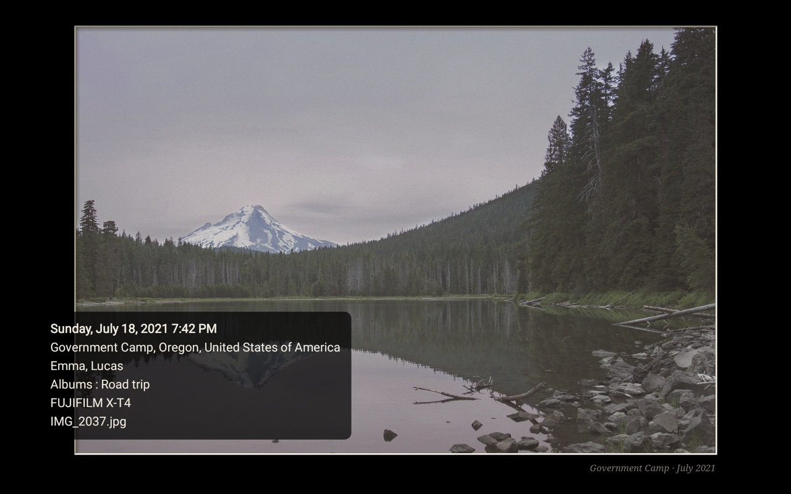
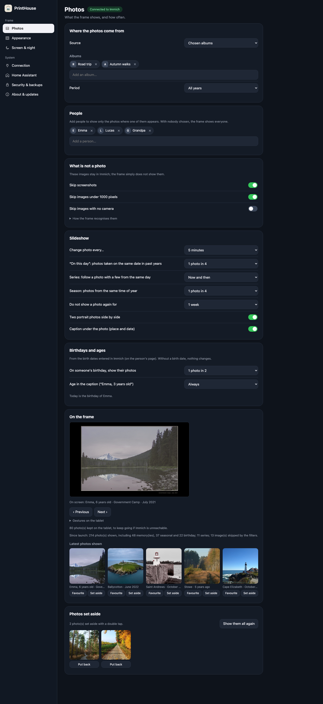
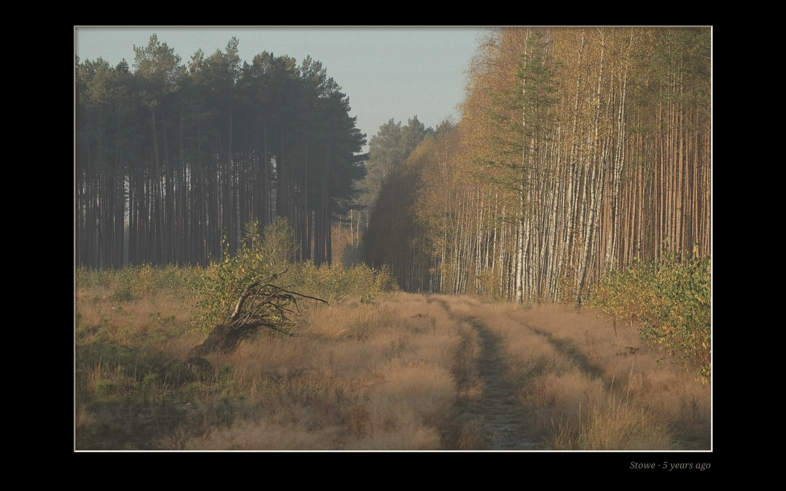
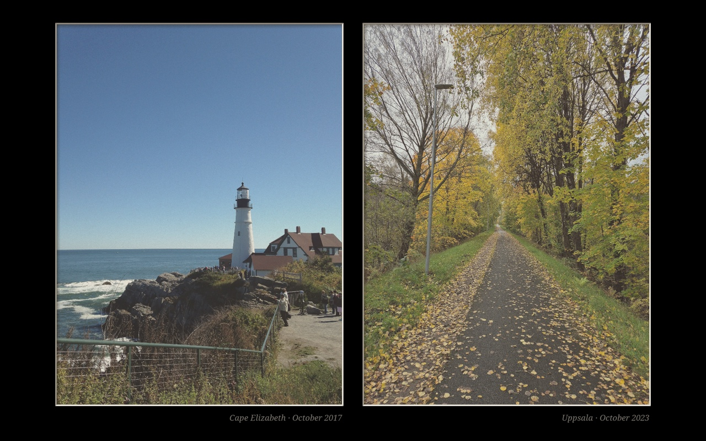
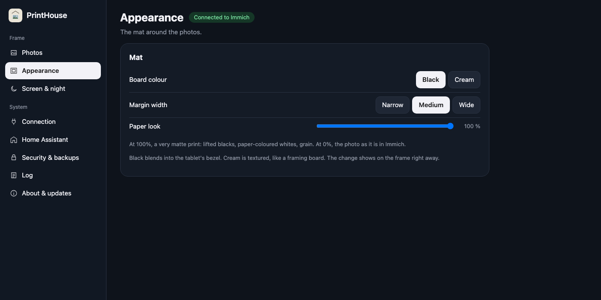
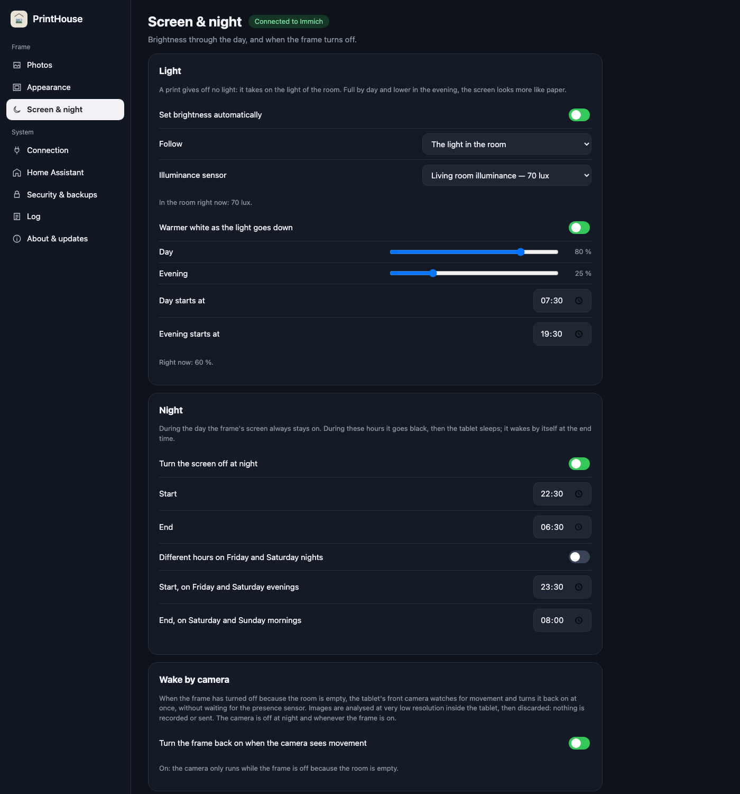
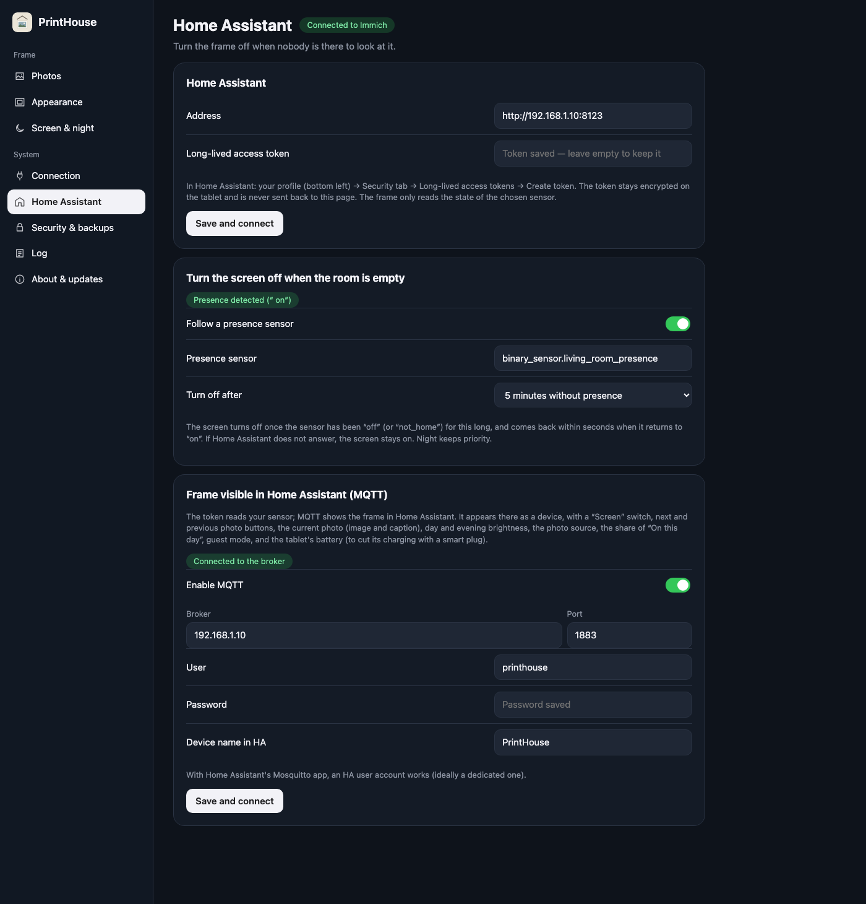
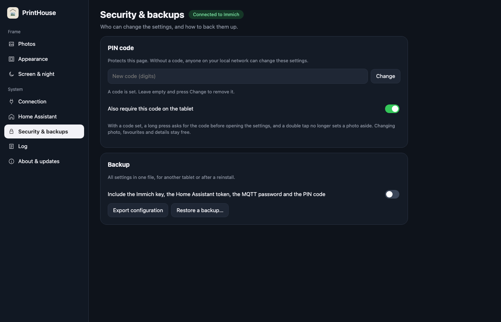
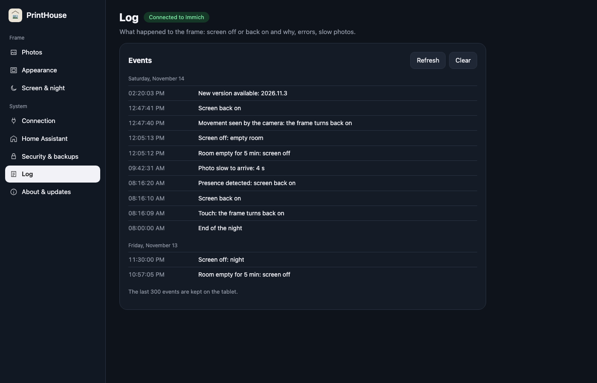
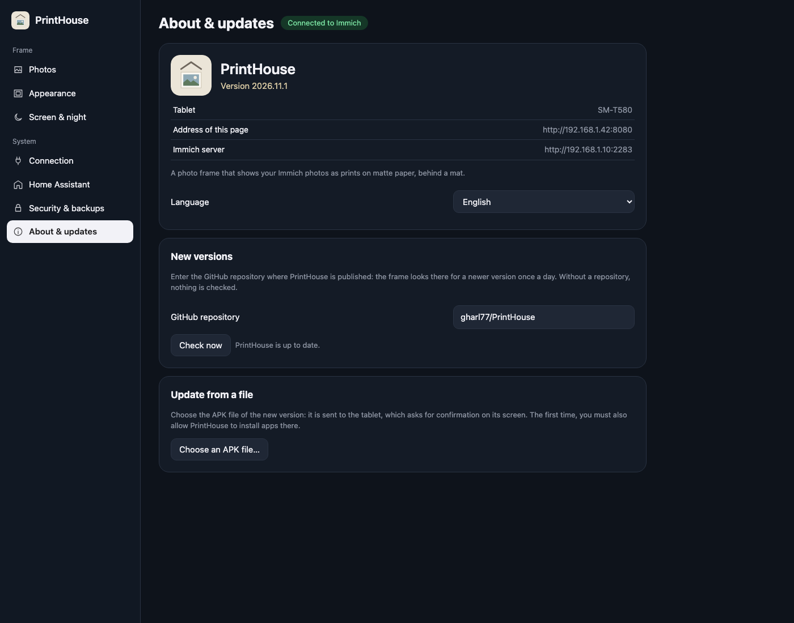

# PrintHouse guide

PrintHouse turns an Android tablet into a photo frame fed by your [Immich](https://immich.app)
server. This guide covers installation, every setting, the gestures, Home Assistant, updates
and troubleshooting.

- [What you need](#what-you-need)
- [Install](#install)
- [Connect to Immich](#connect-to-immich)
- [Using the frame](#using-the-frame)
- [The settings page](#the-settings-page)
  - [Photos](#photos)
  - [Appearance](#appearance)
  - [Screen & night](#screen--night)
  - [Connection](#connection)
  - [Home Assistant](#home-assistant)
  - [Security & backups](#security--backups)
  - [Log](#log)
  - [About & updates](#about--updates)
- [Keeping the frame on screen](#keeping-the-frame-on-screen)
- [Privacy and security](#privacy-and-security)
- [Troubleshooting](#troubleshooting)
- [How the print look is made](#how-the-print-look-is-made)
- [Build from source](#build-from-source)

## What you need

- An Android tablet running Android 8.0 or later, kept plugged in. PrintHouse is developed on
  a Samsung Galaxy Tab A 10.1 (2016).
- An Immich server the tablet can reach on your network, and an API key for it.
- Optional: Home Assistant, to turn the screen off when the room is empty or to control the
  frame.

The frame is designed for landscape use. Portrait photos are shown whole, or two side by side.

## Install

Copy the APK to the tablet and open it, or install it from a computer over USB:

```
adb install -r PrintHouse-<version>.apk
```

The first time PrintHouse opens with no server configured, it opens its settings screen and
shows the address of its web settings page.

## Connect to Immich

1. In Immich, open **Account Settings → API Keys → New API Key**.
2. Tick the permissions PrintHouse needs:

   | Permission | Needed for |
   | --- | --- |
   | `asset.read` | Finding photos, reading their date and place |
   | `asset.view` | Displaying the images |
   | `album.read` | Listing albums and showing photos from chosen albums |

   Themes ("dog", "landscape") need no extra permission, but they rely on Immich's smart
   search, so machine learning must be enabled on your server.
   | `person.read` | Optional — choosing people, ages, and names in photo details |
   | `asset.update` | Optional — adding a photo to favourites from the frame |
   | `memory.read` | Optional — "On this day" in a single request instead of about fifty |

3. On the tablet, long-press the screen and enter the Immich address (for example
   `http://192.168.1.10:2283`) and the key. Or open the web settings page from a computer and
   use the **Connection** section — pasting a long key is easier there.

PrintHouse only ever reads from Immich, except for the optional "add to favourites" gesture.

## Using the frame


The frame changes photo by itself at the interval you choose, with a slow fade through the bare
mat. A small caption under the photo gives the place and the month.

| Gesture | Action |
| --- | --- |
| Tap, or swipe left | Next photo |
| Swipe right | Previous photo (up to 60 back) |
| Swipe up | Add the photo to Immich favourites |
| Swipe down | Show the photo's details for a few seconds |
| Double tap | Set the photo aside: it will not come back |
| Long press | Open the settings |

With two photos on screen, the gesture applies to the photo under your finger.

When the frame is black — at night, or because the room was reported empty — the first touch
only turns it back on: for two minutes at night, otherwise until the presence sensor reports
the room empty again for the chosen delay.



A photo set aside is only hidden on this tablet; nothing changes in Immich. You can put it back
from the web page.

## The settings page

The tablet serves its own settings page at `http://<tablet address>:8080` for as long as
PrintHouse is running. The address is shown at the bottom of the tablet's settings screen and
in **About & updates**. Add `#photos`, `#look`, `#screen`, `#conn`, `#ha`, `#security`, `#log` or
`#about` to open a section directly.

Every change is saved as you make it and applies to the frame right away. Sections with a
**Save and connect** button (Immich, Home Assistant, MQTT) are sent when you press it.

### Photos



**Where the photos come from**

Three lists add up. A photo is shown if it matches any one of them; with all three empty, the
frame draws from the whole library.

- **People** — photos where one of these people appears. Needs `person.read`.
- **Themes** — photos recognised by their content: "dog", "landscape", "snow". A theme is a
  search, run by Immich's machine learning exactly as in Immich's own search box, so write it in
  the language your Immich understands best. Immich ranks photos from the closest to the least
  close without saying where the theme ends, so you choose how many to keep per theme (50 to
  500): more gives more variety and more intruders. A double tap on the frame sets an intruder
  aside for good. Each theme costs one request a day.
- **Albums** — every photo of these albums, whoever is in them. Large albums come up more often
  than small ones.

Each list has a **share of the slideshow** — a little, as much as the rest, a lot — so that
landscapes do not drown the family, or the other way round. Every batch of photos is split
between the lists by these shares, then shuffled.

Above the lists, **Draw from** limits everything to your favourites if you wish, and **Period**
to the last 1, 2, 5, 10 or 20 years.

People and albums are chosen by typing a name and picking a suggestion; themes are typed
freely. Each choice becomes a token you can remove.

"On this day" memories and season photos follow your people and albums. With themes as the
only list they are left out, because nothing can limit them to a theme.

**What is not a photo**

These images stay in Immich; the frame just skips them.

| Setting | Default | Rule |
| --- | --- | --- |
| Skip screenshots | On | The file name contains "screenshot" or "capture d'écran", or it is a PNG with no camera brand |
| Skip images under 1000 pixels | On | The longest side is under 1000 pixels |
| Skip images with no camera | Off | No camera brand or model in the file. This also skips scanned prints and photos received by messaging |

**Slideshow**

- **Change photo every…** — 1 minute to 1 hour.
- **On this day** — how often a photo taken on today's date in a past year is shown: never, 1
  photo in 4, 1 in 2, or memories only. Its caption reads "5 years ago" instead of the month.
- **Series** — how often a photo is followed by up to three more from the same day, in the
  order they were taken, like turning the pages of an album.
- **Season** — how often a photo from the same time of year (three weeks either side of today)
  in a past year is shown: winter in winter, summer in summer.
- **Do not show a photo again for** — 3 days to 1 month. The frame remembers what it has shown
  and avoids it; if the filters leave nothing else, it shows a recent photo rather than nothing.
- **Group two portrait photos, or three square ones** — in the same mat, each with its
  caption.
- **Caption under the photo** — place and month, in pencil-like italics.





**Birthdays and ages**

Both use the birth dates entered in Immich (on each person's page) and need `person.read`.

- **On someone's birthday, show their photos** — no more than usual, 1 photo in 2, or only
  their photos. With people chosen above, only their birthdays count.
- **Age in the caption** — never, on their birthday only, or always: "Emma, 3 years old ·
  Lisbon · July 2019", for up to two people per photo. Babies get months.
- **Show the age of** — everyone, or only people under 18 (the default), 13 or 6 at the time of
  the photo.

The age is worked out from the date Immich holds for the photo, and is shown only when that
date comes from the camera. A scanned print with no camera date gets no age. An old print
re-photographed with a phone carries the phone's date and would show a wrong age: correct its
date in Immich.

**Guest mode**

One switch limits the frame to a single album of your choice — no people filter, memories,
birthdays or ages — and your usual settings return when you turn it off. The same switch exists
in Home Assistant when MQTT is enabled.

**On the frame** shows a live preview of the frame, what is currently displayed, and
**Previous** and **Next** buttons. Under it:

- how many photos are kept on the tablet — the last 80 shown are stored locally so the frame
  keeps going when Immich is unreachable;
- counters since the app started: photos shown, memories, seasonal and birthday photos, series,
  and images skipped by the filters;
- **Latest photos shown** — the last twelve, each with **Favourite** and **Set aside** buttons,
  so you can act on a photo you saw go by without walking to the frame.

**Photos set aside** lists every photo hidden with a double tap, with a thumbnail and a **Put
back** button, and a button to show them all again.

### Appearance



- **Board colour** — *Black* is plain and blends into the tablet's bezel. *Cream* is textured
  like a framing board, with soft room light across it.
- **Margin width** — narrow, medium or wide.
- **Paper look** — how strongly the photo is turned into a matte print. At 100 % blacks are
  lifted, whites take the colour of paper and grain is added; at 0 % the photo is shown as it
  is in Immich.


### Screen & night



- **Brightness by time of day** — one brightness for the day and one for the evening, with a
  gradual half-hour change at each boundary. A dim screen in a dark room looks far more like a
  print. Turn it off to leave brightness to the tablet.
- **Night** — between the start and end times the screen goes black, then the tablet really
  sleeps; it wakes by itself at the end time. During the day the screen always stays on.
  Friday and Saturday nights can have their own hours.
- **Wake by camera** — off by default. When the frame has turned off because the room is
  empty, the tablet's front camera watches for movement and turns the frame back on at once,
  without waiting for the presence sensor. Images are compared at very low resolution inside
  the tablet and discarded; nothing is recorded or sent. The camera is off at night and
  whenever the frame is on. Android asks for camera access on the tablet when you enable it.

### Connection

The Immich address and API key. **Save and connect** checks them and loads your albums and
people. Leave the key field empty to keep the saved key.

### Home Assistant



PrintHouse links to Home Assistant in two independent ways.

**Turn the screen off when the room is empty (token)**

1. In Home Assistant, open your profile → **Security** → **Long-lived access tokens** → **Create
   token**.
2. Enter the Home Assistant address and the token, then **Save and connect**.
3. Pick a presence sensor and a delay, and turn on **Follow a presence sensor**.

The screen turns off once the sensor has been `off` (or `not_home`) for the chosen delay and
comes back within a few seconds, with a new photo, when it returns to `on`. A sensor can take a
moment to notice you; touching the frame turns it on at once. Binary sensors, people, device
trackers, input booleans and groups are offered. A true presence sensor works better than a
motion sensor, which goes `off` as soon as you sit still. If Home Assistant does not answer,
the screen stays on. Night keeps priority. PrintHouse only reads this one sensor; it writes
nothing to Home Assistant.

**Show the frame in Home Assistant (MQTT)**

A token cannot create a device in Home Assistant, so this part uses MQTT discovery. Enter your
broker, user and password. The frame then appears under the MQTT integration as a device with:

| Entity | Type | What it does |
| --- | --- | --- |
| Screen | Switch | Turns the screen off and on. Turning it on also overrides an "empty room" switch-off |
| Next photo, Previous photo | Buttons | Change the photo |
| Photo on display | Sensor | The caption of the current photo |
| Current photo | Image | The picture currently on the frame, mat included |
| Day brightness, Evening brightness | Numbers | 1–100 % |
| Battery, Charging | Sensor, binary sensor | The tablet's battery level and whether it is charging |
| Guest mode | Switch | Limits the frame to the guest album |
| Photo source | Select | Whole library, or favourites only |
| On this day | Select | Never, 1 photo in 4, 1 in 2, memories only |

Entity names follow the frame's language. An example automation that shows only memories on a
birthday:

```yaml
automation:
  - alias: PrintHouse memories on the anniversary
    triggers:
      - trigger: time
        at: "07:00:00"
    conditions:
      - condition: template
        value_template: "{{ now().strftime('%m-%d') == '06-14' }}"
    actions:
      - action: select.select_option
        target:
          entity_id: select.printhouse_on_this_day
        data:
          option: Memories only
```

A frame is plugged in all year, which wears a battery kept at 100 %. With the battery sensor
and a smart plug you can let Home Assistant charge the tablet only between, say, 40 % and 80 %.

While either link is active, PrintHouse keeps the tablet's processor and Wi-Fi awake so the
frame can be woken remotely when its screen is off.

### Security & backups



- **PIN code** — protects the settings page. Without a code, anyone on your local network can
  change the settings.
- **Also require this code on the tablet** — a long press then asks for the code before
  opening the settings, and a double tap no longer sets a photo aside. Changing photo,
  favourites and details stay available.
- **Backup** — export every setting to a JSON file and restore it later or on another tablet.
  Secrets (Immich key, Home Assistant token, MQTT password, PIN) are left out unless you tick
  the box; a backup restored without them keeps the secrets already on the tablet.

### Log



The frame keeps its last 300 events on the tablet: when and why the screen turned off or came
back on (night, empty room, Screen switch, a touch, movement seen by the camera), errors
talking to Immich or Home Assistant, photos that took more than three seconds to arrive,
updates and restarts. When the frame was black or seemed frozen, this is where to look.

### About & updates



- **Language** — automatic (French if the tablet is in French, English otherwise), French or
  English. It applies to the frame, the tablet's settings screen and the web page.
- **New versions** — enter a GitHub repository as `account/repository`. The frame looks for a
  newer release there once a day and offers an **Install** button. With no repository, nothing
  is checked and GitHub is never contacted.
- **Update from a file** — choose an APK and it is sent to the tablet.

Android always asks for confirmation on the tablet's screen before installing, and the first
time you must allow PrintHouse to install apps. After an update the frame restarts by itself.

## Keeping the frame on screen

- PrintHouse keeps the screen on whenever it is in the foreground and it is not night.
- It starts by itself when the tablet boots and after an update, and shows over the lock
  screen.
- The Back button does nothing on the frame.
- If the app ever crashes, it closes and Android restarts it two seconds later.
- To make the Home button return to the frame, set PrintHouse as the tablet's home app
  (Settings → Apps → Default apps → Home screen), or from a computer:

  ```
  adb shell cmd package set-home-activity com.printhouse.app/.MainActivity
  ```

## Privacy and security

- The Immich API key, the Home Assistant token, the MQTT password and the PIN are encrypted on
  the tablet with a key held in the Android Keystore. The settings page never receives them
  back; it only knows whether each one is set.
- The settings page is plain HTTP on your local network. Set a PIN if other people share that
  network, and do not expose port 8080 to the internet.
- Photos kept for offline use are stored in the app's private cache and are removed when you
  uninstall the app.
- PrintHouse contacts only the servers you configure: Immich, Home Assistant, your MQTT broker
  and, if you set a repository, GitHub.

## Troubleshooting

| What you see | Likely cause |
| --- | --- |
| "API key refused by Immich (HTTP 401)" | The key is wrong or was deleted in Immich |
| A message ending in "(HTTP 403)" | The key lacks a permission; the message names the Immich path concerned. See [Connect to Immich](#connect-to-immich) |
| The people list is empty | Add `person.read` to the key, and name the people in Immich |
| A message saying Immich is unreachable | Wrong address, Immich is down, or the tablet is off the network. The frame keeps showing the photos it has stored |
| MQTT: "not authorised" | The broker rejected the user or password. With the Mosquitto add-on, use the login name of a Home Assistant user |
| The screen turns off while you are in the room | The sensor is a motion sensor. Use a presence sensor or a longer delay |
| You wonder why the frame was off, or slow | Open the **Log** section of the settings page |
| The frame is black when you walk in | The presence sensor has not noticed you yet. Touch the frame, or wait a few seconds |
| A theme brings unrelated photos | Keep fewer photos per theme, word the theme as Immich's own search understands it, and double-tap intruders to set them aside |
| "Immich's content search is not answering" under Themes | Machine learning is off or busy on the Immich server. People and albums keep working meanwhile |
| The dog and the landscapes never show | Choosing people shows only photos with those people. Add themes or albums: the lists add up |
| The same few photos keep coming back | The filters (albums, people, period, not-a-photo) leave few photos to choose from |
| The update asks to "allow from this source" | Normal the first time: allow it on the tablet, then send the file again |
| The settings page does not open | PrintHouse must be running; check the address in the tablet's settings screen. The address can change if your router does not reserve it |

## How the print look is made

Each photo is composed once into a full-screen image:

- **Mat** — the whole screen is the board. The window has a 45° bevel whose faces towards the
  light are bright and the others in shade, and the board casts a thin shadow onto the print.
- **Ink on matte paper** — saturation and contrast are eased slightly, then the whole tonal
  range is remapped between the darkest black a matte ink gives and the white of the paper, so
  nothing is ever screen-black or screen-white.
- **Grain** — a fine paper grain lies over the ink.
- **No interface** — no clock, no buttons, no progress bar; the caption is the only text.

Photos are never cropped: the window takes the shape of the photo.

## Build from source

```
./gradlew assembleRelease
adb install -r app/build/outputs/apk/release/app-release.apk
```

You need JDK 17 and the Android SDK, with its path in `local.properties` (`sdk.dir=…`). The
app has no dependency beyond Kotlin and the Android framework. The release build is minified
and signed with the development key.

```
./gradlew testReleaseUnitTest
```

runs the unit tests: the time, night, age, birthday and version calculations, the screenshot
rule, the choice of photos against a fake Immich that counts requests (no setting may make one
photo cost more than a handful), and a check that every French text of the app and of the web
page has its English translation.

| File | Role |
| --- | --- |
| `MainActivity.kt`, `FrameView.kt` | The frame: gestures, fades, night, brightness |
| `PrintRenderer.kt` | Draws the mat and the prints |
| `Picker.kt` | Choosing the next photo; no Android, tested against a fake Immich |
| `Library.kt`, `Immich.kt` | Pages, history, offline reserve; talking to Immich |
| `EventLog.kt`, `MotionWake.kt` | The log; wake by camera |
| `Logic.kt` | Pure calculations, covered by the unit tests |
| `WebServer.kt`, `assets/config.html` | The settings page and its API |
| `HaLink.kt`, `MqttDevice.kt`, `MqttClient.kt` | Home Assistant by token; MQTT device |
| `Settings.kt`, `SecretBox.kt` | Settings and encrypted secrets |
| `I18n.kt`, `I18nEn.kt` | French (the source language) and the English dictionary |
| `Updater.kt`, `WakeReceiver.kt` | Updates; boot and morning wake-up |
